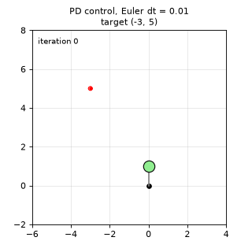
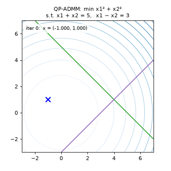
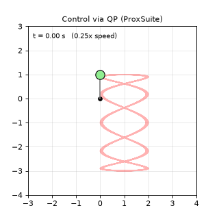
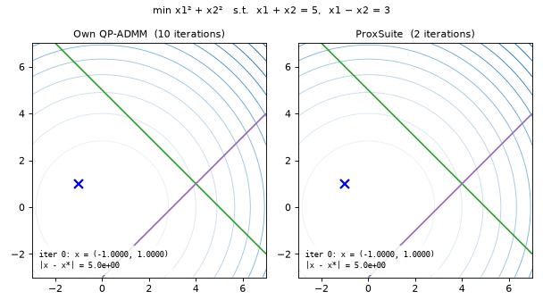
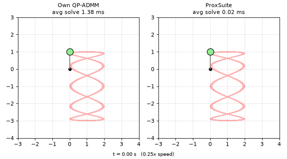

# Quadratic-Programming-via-Alternating-Direction-Method-of-Multipliers

This repository contains an implementation of **Algorithm 1** from the paper ["OSQP: An Operator Splitting Solver for Quadratic Programs"](https://arxiv.org/pdf/1711.08013), a Quadratic Programming (QP) solver based on the **Alternating Direction Method of Multipliers (ADMM)**, and its use as a controller for a simplified **hopper robot**. The [project](https://github.com/ChouliarasVasileios/Quadratic-Programming-via-Alternating-Direction-Method-of-Multipliers/blob/main/ECEUoP_RS_2_HW_1.pdf) was developed as part of the **Robotic Systems II** course at the **Department of Electrical and Computer Engineering, University of Patras**, supervised by **Assistant Professor Konstantinos Chatzilygeroudis**.

## Overview

| Modeling & PD control | QP-ADMM solver | Control via QP |
|:---:|:---:|:---:|
|  |  |  |
| PD controller drives the hopper from x₀ = [0, 1, 0, 0]ᵀ to the target (−3, 5) — Euler integration, dt = 0.01, 171 iterations | ADMM iterates on min x₁² + x₂² s.t. x₁ + x₂ = 5, x₁ − x₂ = 3, converging to ≈ (4, 1) in 10 iterations | QP-based controller tracking the red reference trajectory, RK4 with dt = 0.005 (first 4 s, shown at 0.25× speed) |

## Own QP-ADMM vs ProxSuite

The QP-ADMM solver implemented here (left) is compared with the [ProxSuite](https://github.com/Simple-Robotics/proxsuite) solver (right) on both the Part 2 test problem and the Part 3 controller.

### Part 2: test QP

Both solvers start from x₀ = (−1, 1) on min x₁² + x₂² s.t. x₁ + x₂ = 5, x₁ − x₂ = 3, whose exact solution is x* = (4, 1).



| | Own QP-ADMM | ProxSuite |
|---|:---:|:---:|
| Solution | (3.9952, 1.0000) | (4.0000, 1.0000) |
| Error ‖x − x*‖ | 4.8 × 10⁻³ | 1.0 × 10⁻⁶ |
| Constraint violation ‖Ax − b‖ | 6.7 × 10⁻³ | 1.5 × 10⁻⁶ |
| Iterations | 10 | 2 |
| Solve time | ≈ 1.3 ms | ≈ 0.03 ms |

QP-ADMM reaches the solution within its stopping tolerance (ε_abs = 10⁻⁴, ε_rel = 10⁻³), while ProxSuite, a primal-dual proximal method, converges to machine-level accuracy in 2 iterations.

### Part 3: control via QP

The same QP controller run with each solver. Both start from x₀ = [0, 1, 0, 0]ᵀ and track the same reference trajectory.



| | Own QP-ADMM | ProxSuite |
|---|:---:|:---:|
| Average solve time per control step | ≈ 1.4 ms | ≈ 0.02 ms |

The QP-ADMM solver converges at every control step and the closed-loop behaviour is practically identical to ProxSuite. ProxSuite is faster, since it is an optimized C++ solver while QP-ADMM is written in pure Python/NumPy.

## Project Overview
The aim of this assignment was to:

- **Model** the dynamics of a simplified hopper robot (a point mass in the 2D plane, actuated by a leg force *f* and a perpendicular force *τ*) and discretize it with **Euler, Semi-Implicit Euler, Runge–Kutta 4 and Midpoint** integrators.
- Control the body position with a simple **PD controller**.
- Implement a generic equality-constrained **QP solver via ADMM (Algorithm 1)**, including primal/dual infeasibility detection, and validate it against [ProxSuite](https://github.com/Simple-Robotics/proxsuite).
- Demonstrate how **Quadratic Programming can be used as a controller**: at every time step a QP finds the accelerations and forces that respect the system dynamics while tracking a desired trajectory.

## Repository Structure

| File | Description |
|---|---|
| `Modeling_Part1.py` | Hopper robot dynamics, the four integrators, PD controller and matplotlib visualization |
| `QP_ADMM_Part2.py` | `QP_ADMM_LC` — QP solver via ADMM (Algorithm 1), tested on a 2-variable problem and compared with ProxSuite |
| `Control_via_QP_Part3.py` | Trajectory tracking of the hopper using a QP controller (ProxSuite or the own QP-ADMM solver) |

## Installation

```bash
git clone https://github.com/ChouliarasVasileios/Quadratic-Programming-via-Alternating-Direction-Method-of-Multipliers.git
cd Quadratic-Programming-via-Alternating-Direction-Method-of-Multipliers
python3 -m venv .venv
source .venv/bin/activate
pip install -r requirements.txt
```

## Usage

```bash
python Modeling_Part1.py           # Part 1: modeling + PD control
python QP_ADMM_Part2.py            # Part 2: QP-ADMM solver vs ProxSuite
python Control_via_QP_Part3.py     # Part 3: control via QP
```

## Report
A detailed technical report ([Homework1_Robotics_Systems_II.pdf](https://github.com/ChouliarasVasileios/Quadratic-Programming-via-Alternating-Direction-Method-of-Multipliers/blob/main/Homework1_Robotics_Systems_II.pdf)) is provided in Greek, documenting:

- The mathematical modeling of the system
- Quadratic Programming via the Alternating Direction Method of Multipliers (ADMM)
- Simulation results

## Acknowledgements
This project was completed as part of the Robotic Systems II course at the University of Patras under the guidance of **Assistant Professor Konstantinos Chatzilygeroudis**.
